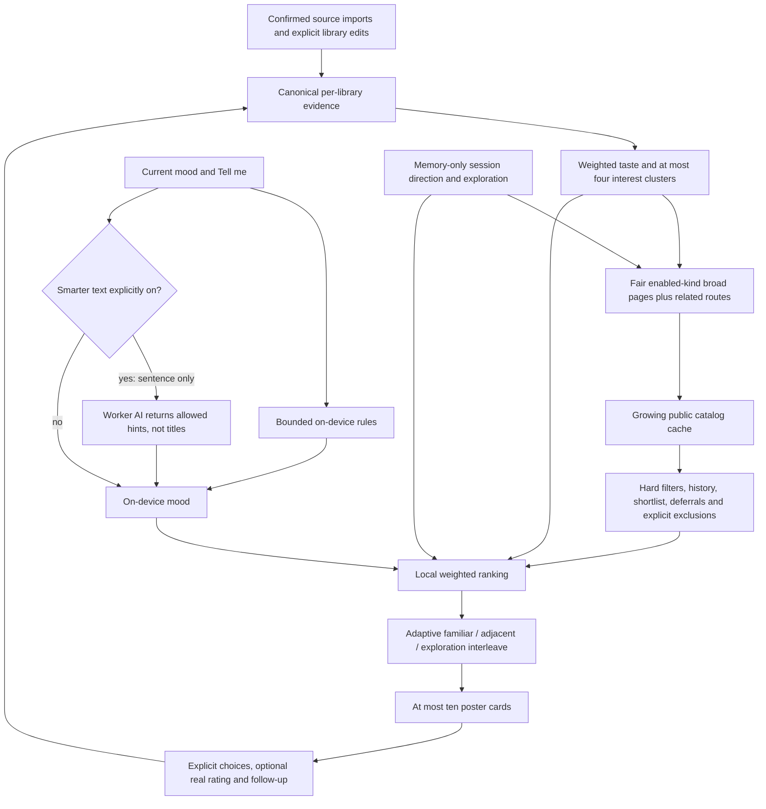

# Cue

**Your next story, one swipe at a time.**

Cue is a free, private recommender for **anime, manga, manhwa, manhua, K/C/J-dramas, series and movies**. Open it, see one poster, swipe. It learns what you are in the mood for and keeps your history on your own device.

No required account, ads, third-party analytics SDKs or trackers. Optional technical diagnostics are off until you explicitly consent.

| | |
|---|---|
| **Web app** | https://cue-next.cue-worker.workers.dev |
| **Android** | build the APK (see [Run it yourself](#run-it-yourself)) |

---

## Contents

- [What it does](#what-it-does)
- [Live mood](#live-mood)
- [Privacy](#privacy)
- [How it works](#how-it-works)
- [Run it yourself](#run-it-yourself)
- [Deploy your own copy](#deploy-your-own-copy)
- [Project layout](#project-layout)
- [Status](#status)

---

## What it does

- **Swipe deck.** Right = *Will try*, left = *Not interested*, up = *Watched / Read it*, down = *Not now* (hidden for 14 days). Remap any direction in Settings. Buttons, arrow keys and screen readers work too. Double-tap is the only additional gesture: **Try now**, a saved priority marker, not a rating, consumption or playback. Its accessible equivalent is in Filters > Session picks and Why; keyboard: Shift + Enter. Undo restores the previous state unless a newer edit makes that unsafe.
- **Honest reasons.** Every card says why it is there ("because you rated X highly"). No fake match percentages.
- **Bring your history.** Upload a MyAnimeList XML, Netflix viewing activity, a Mihon/Tachiyomi backup, any CSV or Excel sheet with a Title column, or a Cue backup. Or sign in to MyAnimeList, or type a public AniList username. Everything is previewed first and every import can be undone.
- **Imports survive closing the app.** Matching resumes from a local checkpoint for the active library. Ready previews and your inclusion choices stay on this device until you confirm or cancel; they are never automatically imported or synced. Interrupted catalog requests may be repeated, but completed matching chunks are kept.
- **One combined history per library.** Excel and MAL imports merge into the selected library using matched catalog identities, preserving stronger statuses and your manual edits. Different local libraries stay separate; unmatched or uncertain rows still need review before they become known history.
- **Review later.** Library exposes unresolved import rows; each library's review queue survives reopening. Resolving a title updates that library, not the active neighbour. Import sources are not new recommendation providers.
- **Optional Rate your library.** Loved, Enjoyed, One-time and Dropped are explicit answers, not automatic ratings for imported history. Skip, dismiss and Haven't started do not pretend you consumed or liked a title. Follow-up prompts are optional for older, unrated saved picks and respect dismissal. Rating Undo checks for newer edits.
- **Pick from saved.** Tonight's picks is a filter of the existing shortlist's Try now markers, not another list. Saved options includes a card picker and a two-title factual comparison. Unknown metadata stays unknown; Cue does not invent a winner. Saved titles remain excluded from ordinary discovery.
- **New means new.** Suggestions exclude all titles already saved in the selected library, including watching, reading and planned titles. The old default-rewatch preference no longer brings history into ordinary suggestions. Choose **Revisit** explicitly for titles rated Rewatched / Would rewatch, or with an actual watch date more than three years ago.
- **Browse each local library.** In Settings > This library, tap a library to see its titles grouped by media type and sorted by name. Search or filter by anime, movies, dramas and reading types; remove incorrect titles with confirmation. Browsing does not switch libraries: use **Use this library** to switch. You can delete any local library independently; deleting the last one creates a fresh empty library.
- **One title, many names.** Manhwa and manhua often have 3 or 4 names. Cue checks official, romanised and fan names (AniList, MangaDex, MangaUpdates) and asks you before linking anything it is unsure of.
- **Sync between phone and web** with a code, end-to-end encrypted. Optional.

## Live mood

Cue works out what you feel like **right now**, on your device:

- It learns your **modes** from what you pick (for example "Isekai · Fantasy" or "Romance · Comedy") and notices within a few swipes when you switch.
- It learns what **your words** mean ("grind", "slow", "trash") from what you choose after typing them. Recognised format and genre keywords work immediately; other word meanings are learned from your picks.
- A **"Cue read: …"** chip shows its guess. Tap to correct it, long-press to rename a mood.
- Recognised format and positive genre words set strict filters: "fast paced comedy kdrama" requires K-drama and Comedy, not Action. The filter sheet also exposes required genres. Mood and pacing remain soft preferences because catalog pace metadata is incomplete; no instant pace guarantee or AI subscription is required.
- Local rules handle bounded synonyms and reliable negation, not general natural-language understanding. The sheet shows understood constraints and unmapped text. Changing or clearing Tell me removes its earlier derived constraints without removing unrelated manually selected filters. Unknown genres cannot prove "without horror"; hard filters are never silently broadened.
- Optional **Smarter mood text** (off by default) sends only the sentence you type to an AI service (Groq, falling back to Google Gemini) for genre hints.
- **Session direction is separate.** More/Less, supported "more of this trait", exploration and Try now's extra immediate-interest signal stay in memory. They expire after 45 minutes away, a new local day, library switch, app process restart or Reset session. They never become ratings, permanent exclusions, learned moods or synced taste. Public catalog metadata fetched along those routes can remain cached.
- In the existing Filters sheet, **Surprise me** changes the next five choices within hard filters, then restores your exploration preference. After repeated Not now, an optional dismissible **Different direction** suggestion clears temporary direction and shifts the mix. There is no triple-tap or gesture combination. Bring back later has optional Too long / Wrong mood / Saving for later context; these reasons are session-only. Not now's delay persists, but it does not train a lasting negative mood.
- Details has known-trait direction, local correction/review shortcuts and, only for verified TMDB movie collection identities, a confirmed franchise preference. This covers cached members with the same verified collection ID, not unknown members or cross-provider adaptations. It never guesses a franchise from a title string. Restore in Settings > Recommendation preferences; Reset swipes preserves this deliberate preference. Local rating/review correction cannot repair provider artwork, synopsis or genres and uploads no correction report.

Clear everything any time in *Settings > Privacy*.

## Privacy

- Your library lives on your device (SQLite). Library/history uploads require encrypted sync. Optional technical diagnostics and opt-in AI text are separate, explicitly enabled features.
- Sync encrypts the library on the device (AES-256-GCM, keys derived from your 32-character code). The server stores only ciphertext and cannot read it.
- Catalog lookups send title names or catalog ids, never your history.
- Sign-in uses the provider's own page. Cue never sees a password. Tokens stay on the device.
- Pending imports keep parsed records (and uploaded bytes for date correction and duplicate detection) only in the local database. Confirming or cancelling removes that temporary payload; backups and sync contain no pending imports.
- Title removals use encrypted sync tombstones so an older device cannot silently add them back. An explicit later edit or confirmed re-import can restore a title. Deleting an entire local library forgets its local sync code but does not delete the server's encrypted copy or another device's library.
- Recommendation measures (choice counts, explicit follow-up outcomes, exposure/repetition, format coverage and detected constraint leaks) are device-only proxies, not an accuracy score. They are excluded from sync, backups and technical diagnostics; they can be cleared independently. They do not prove unseen catalog coverage or real-world enjoyment.
- **Technical diagnostics:** Settings > Privacy explains consent before enabling. Only random request IDs, numeric app version, fixed provider/operation/status/error codes and bounded elapsed time are allowed. Never title names, Tell me/search text, history, imported files, URLs, tokens, keys, response bodies or raw error messages. There is no retrospective disk backlog. Turning off discards pending events and stops collection/uploads. A failing preference write is reported rather than silently claiming durable success.
- Diagnostics uses an authenticated random recovery capability, not public logs or CORS as authentication. Keep its export/recovery code private; a later CLI session can use the documented authenticated export. No server secret is embedded in the app. At most 20 events/upload, first 100 unique events/session, 1,000 sessions globally; fixed seven-day expiry from first accepted upload, payload/rate/storage safeguards and explicit quota/unavailable errors. Expired records are inaccessible; physical pruning is opportunistic on later diagnostics requests, not a scheduled deletion guarantee. No paid-plan upgrade or guaranteed free-forever promise. See [Worker diagnostics](worker/DIAGNOSTICS.md).
- The diagnostics implementation requires the matching Worker build and D1 migration `0002_diagnostics.sql`; local implementation does not make an older deployed Worker support it. Technical-only events cannot diagnose semantic title mismatches without title data.
- No ads, third-party telemetry SDKs, trackers or remote fonts.

## How it works

```
 Flutter app (Android, web)                              Cloudflare Worker (free plan)
 +------------------------------+   HTTPS, fixed routes  +-------------------------------+
 | deck, ranker, live mood      | ---------------------> | /catalog  TVmaze, Cinemeta,   |
 | imports, library, sync       |                        |           MangaDex, MangaUpd. |
 | local SQLite (Drift)         |                        | /oauth    MAL token exchange  |
 +--------------+---------------+                        | /import   MAL list reads      |
                | HTTPS                                  | /sync     encrypted blobs (D1)|
                v                                        | /ai/mood  Groq / Gemini hints |
        graphql.anilist.co                               +-------------------------------+
   (anime and comics, called from the device,
    because AniList blocks Cloudflare)
```

| Data | Source | Key needed |
|---|---|---|
| Anime, manga, manhwa, manhua | AniList | no |
| K/C/J-dramas, series | TVmaze | no |
| Movies | Stremio Cinemeta (unofficial) | no |
| Comic alternate names | MangaDex, MangaUpdates | no |

**Tech:** Flutter, Riverpod, go_router, Drift · Cloudflare Workers, Hono, zod, KV, D1 · Vitest and flutter_test.

### Recommendation flow and coverage



Cue does **not** download thousands of every kind and choose from the entire catalog at startup. It ranks the cached candidate sample, extending it with bounded provider pages. Each retrieval round has one unfiltered broad route per enabled kind plus at most three supported related-mood routes, capped at 12 requests. Enabled-kind order rotates. Missing kinds are refilled even if another kind fills the cache; unavailable formats are reported. AniList pages have up to 50 titles, Cinemeta offsets advance by 50, and TVmaze discovery samples four index pages (variable result count). App page cursors stop at 50 per kind/mood and refresh after seven days. Explicit hard filters and saved-history exclusions apply to every route and exploration slot. Exhaustion can still happen: retry/refill, review filters explicitly or choose from saved, never silently widen filters or fabricate candidates.

Long-term evidence is counted once per canonical title, not once per import. Explicit ratings dominate: Favourite and Rewatched +3, Would rewatch and Enjoyed +2, One-time +1.5, Okay +0.5, Dropped -1.5 and Disliked -1. Unrated **imported** watching/reading contributes weak +0.20, completed +0.15; planned/on-hold/dropped/unknown contributes no assumed liking. An unrated shortlist contributes +1 instead of adding to weak history; a rating replaces that shortlist signal. Active Not interested contributes -0.3. Missing genre/tag metadata stays neutral. No imported title receives an invented 4/5 rating.

Confidence grows monotonically as `min(1, evidenceStrength / 20)`, where strength sums `min(1, abs(signal))` over distinct metadata-bearing titles. Taste blends from neutral 0.5 towards a 70% tag-cosine / 30% best-cluster-affinity score; weaker clusters are scaled relative to the strongest. Clusters use at most the strongest 64 positive titles, four groups and eight features/group. The default score weights are taste 0.40, mood 0.20, quality 0.15, freshness 0.15 and under-rated-format novelty 0.10; negative-feature penalty is capped at 0.30. A confident learned mood adjusts mood weight to `0.10 + 0.25 * confidence` and taste weight to `max(0.25, 0.40 - (moodWeight - 0.20))`. Session and temporary lean each contribute up to 0.08; recent exposure subtracts 0.04. Known shorter episodic/reading lengths can receive a temporary +0.04 preference versus -0.08 for known longer lengths after Too long; unknown/movie runtime is not guessed.

More/Less uses signals +/-0.6, Try now's temporary interest +0.9, per-event decay 0.85 and per-feature cap +/-1.5. The in-memory reversible journal is capped at 40 events, 32 features/action and 256 retained bias features. For a deck of size N, familiar share is `clamp(0.55 + 0.20 * tasteConfidence - 0.35 * explorationPreference, 0.25, 0.60)`, adjacent slots are rounded `0.20*N`, and the remainder explores. Default preference 0.35 generally yields 4/2/4 cold-start or 6/2/2 warm ten-card decks. Interleaving starts early rather than hiding every other format at the end. Known quality below 40 is avoided for variety when stronger eligible options exist, without claiming missing scores are bad. Franchise/near-duplicate deck grouping is a presentation safeguard, **not** proof sufficient for persistent franchise exclusions.

### Validation boundaries

The regression suites use synthetic libraries, isolated databases and injected
provider/AI failures. They exercise the real app widgets, repositories and
gesture recognizers; platform suites also run those flows on Android and Chrome.
They are production-like checks, not a guarantee of finding every corner case.

| Requirement | Regression coverage |
|---|---|
| Durable imports and review | Persistent SQLite reopen, chunk checkpoints, cancellation/retry/storage failure, explicit preview commit, canonical deduplication and separate profiles |
| Taste versus temporary intent | Weak unrated evidence, explicit rating precedence, gradual confidence, unknown metadata neutrality, More/Less/traits/session expiry without rating or sync writes |
| Retrieval and constraints | Mixed-media seeds and missing-kind refill, bounded pages/requests and exact cache expiry, hard filters/history exclusions, partial failures and honest exhausted recovery |
| Rating and saved picks | Optional answers/Skip/dismissal, explicit overwrite confirmation, exact/stale-safe Undo, factual comparison, saved-only deck and Tonight priority |
| Four swipes and Try now | Single/double-tap/drag arbitration, all original directions, reduced motion, keyboard/custom semantics, duplicate promotion and fractional timestamp Undo |
| Removal and sync | Atomic priority tombstones on entry/shortlist removal and swipe reset, older remote intent rejection, ordinary re-add, two-device conflict convergence and profile isolation |
| Technical diagnostics | Consent OFF/default/no backfill, strict private-field rejection, capability authorization, caps/expiry/races/retries, exact export validation, actual Android client to local Worker/D1 roundtrip |
| Layout and lifecycle | Small phone/desktop, 200% text and scrolling, labelled accessible targets, route/profile changes and asynchronous SQLite readiness |

Actual device checks use an owned disposable emulator, never an emulator in
someone else's active use. Release launch and a saved-priority process-stop/
restart are checked separately from persistent import database reopen. A process
kill *during* import matching, real user databases, real OAuth/camera workflows,
every browser/physical screen reader and every possible network outage are not
claimed as validated. Flutter's release-mode browser test helpers have debug-only
keyboard/semantics limitations; production web launch/CSP/storage checks and
debug-browser interaction checks must be reported separately rather than hiding
those failures. Live AI probes use deliberately synthetic sentences only: a
successful Groq result does not independently establish Gemini key validity.
Cloud diagnostics remain unavailable until their Worker migration/deployment is
separately authorized.

Latest local validation: analyzer clean, **385 app tests** including three
visually reviewed phone/desktop goldens, **68 Android integrated scenarios**,
one additional actual Android diagnostics-client/local-D1 roundtrip, and
**179 Worker tests** plus TypeScript typecheck. The opt-in real-file import test
was intentionally skipped: no personal export was supplied or uploaded. Golden
changes were only the selected synthetic title after the ranking change, not a
new home layout. Browser results are reported separately because debug harness
interactions and unchanged-CSP release execution have different host limits.
Actual Chrome debug integration passed **107/107** cases; the separate
unchanged-CSP release persistence/rating/details/session-data subset passed
**67/67**. A separate unchanged-CSP release deck group passed **7/7** after
test-only bounded WASM-readiness waits; an actual disposed-sync-reference defect
was fixed and regression-tested. These numbers overlap the app scenarios and
must not be added as independent feature coverage. Full release-harness
keyboard/semantics checks have SDK debug-only helper limitations; those actions
are covered in debug Chrome and Android instead of claimed green in release.
The real production-web UI sent **no AI request while OFF**, then a synthetic
opt-in sentence produced **HTTP 200 from Groq**. Diagnostics stayed OFF with no
uploads during that probe. This does not independently validate Gemini.
The isolated release APK was rebuilt and cold-launched; its certificate uses
the documented **debug fallback**, not release credentials.

## Run it yourself

Needs Flutter (stable), Node 22+, and the Android SDK for phone builds.

```sh
# Worker
cd worker
npm ci
npm test && npm run typecheck
npx wrangler dev                    # local Worker on :8787

# App
cd app
flutter pub get
flutter analyze && flutter test
flutter run -d chrome --web-port 7357
flutter build apk --release         # APK in build/app/outputs/flutter-apk/
```

Release APKs are signed with the key named in `app/android/key.properties` (git-ignored). Without it they use the debug key.

**Install on Android:** copy the APK to the phone, open it, and allow installs from that app when asked.

## Deploy your own copy

The bounded architecture targets Cloudflare's free plan; quotas and provider policies can change. Unavailable/quota responses must be handled rather than assuming guaranteed free capacity.

```sh
cd worker
npx wrangler d1 migrations apply cue-sync --remote
npx wrangler deploy

cd ../app
tool/build_web.sh https://<your-worker>.workers.dev
npx --prefix ../worker wrangler deploy
```

Update the KV and D1 ids and `ALLOWED_ORIGINS` in `worker/wrangler.toml` for your account.

### Optional keys

All free. Set secrets from `worker/` with `npx wrangler secret put NAME`. Never put them in the app or in git.

| Name | Turns on | Get it at |
|---|---|---|
| `MAL_CLIENT_ID` (var) + `MAL_CLIENT_SECRET` | MyAnimeList sign-in and username import | myanimelist.net/apiconfig |
| `GROQ_API_KEY` | Smarter mood text | console.groq.com |
| `GEMINI_API_KEY` | Smarter mood text fallback | aistudio.google.com |
| `TMDB_API_KEY` | Richer dramas, series and movies (optional) | themoviedb.org |

For MyAnimeList, register both redirect URLs: `https://<your-site>/auth.html` and `cue://oauth/mal`.

Check how well a list file matches the live catalogs (the file is read from the path you give and never stored):

```sh
cd app
CUE_LIVE_FILE=path/to/your-list.xlsx flutter test test/live/import_check_test.dart
```

## Project layout

```
app/                Flutter app
  lib/app/          theme, routing, providers
  lib/features/     screens: deck, library, imports, settings, sync
  lib/domain/       ranker, live mood (lib/domain/mood), models
  lib/data/         local database, catalog, repositories
  lib/imports/      file detection, adapters, title matching
  lib/sync/         end-to-end encrypted sync
worker/             Cloudflare Worker
  src/catalog/      TVmaze, Cinemeta, MangaDex, MangaUpdates, cache
  src/imports/      MAL lists and token exchange
  src/sync/         encrypted blob store (D1)
  src/ai/           mood hints (Groq, Gemini)
fixtures/           synthetic test files only
```

## Status

Working: deck, ranker, live mood, imports with undo, MyAnimeList sign-in with renewal, AniList by username, library, encrypted sync (titles, lists, settings, mood), Android and web.

Not planned for now: iOS, Trakt, MyDramaList and Prime Video sign-in (their data can still come in as a CSV).

Contributions: keep test fixtures synthetic. Never commit a real export.
