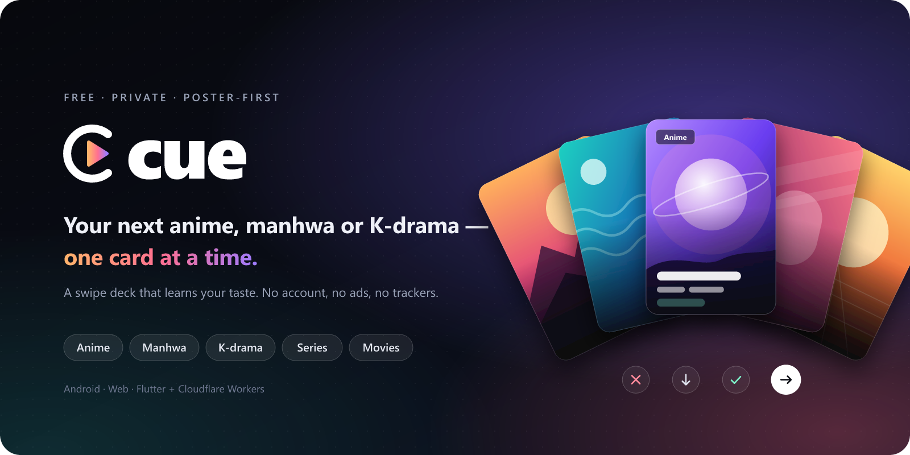
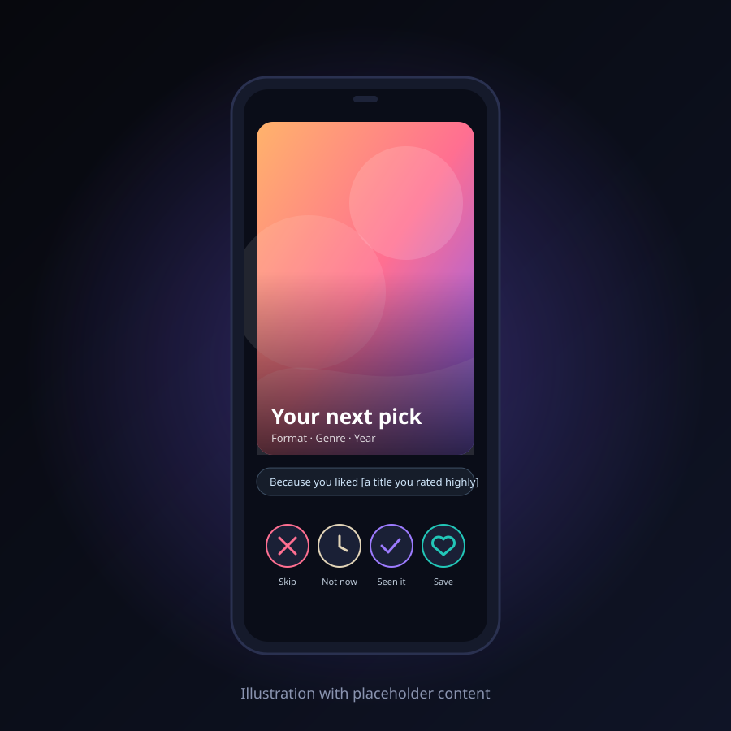
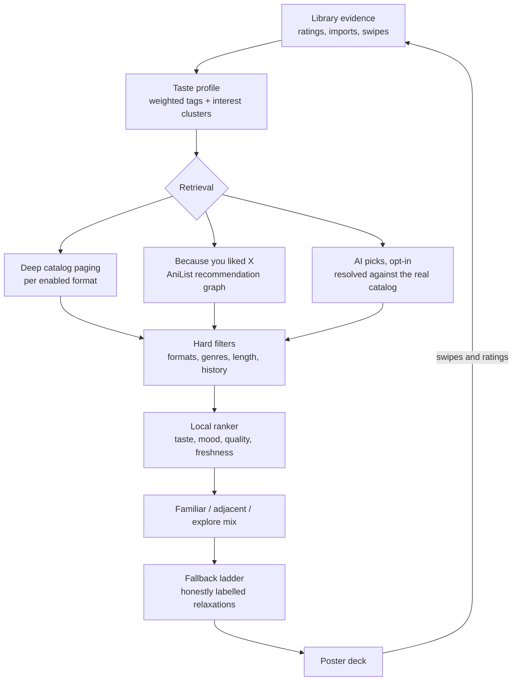

<p align="center">
  
</p>

<p align="center">
  <a href="https://github.com/DdarkSaber/cue/actions/workflows/ci.yml"></a>
  
  
  
</p>

<p align="center">
  <b>A free, private, poster-first swipe deck for anime, manga/manhwa/manhua,<br>
  K/C/J-dramas, series and movies.</b>
</p>

<p align="center">
  <a href="https://cue-next.cue-worker.workers.dev"><b>Open the web app</b></a> ·
  <a href="https://github.com/DdarkSaber/cue/releases/latest"><b>Download for Android</b></a> ·
  <a href="#android">Build it yourself</a> ·
  <a href="docs/FEATURES.md">Feature guide</a>
</p>

---

## Highlights

- **One card at a time.** Swipe right to save, left for Not interested, up for
  Watched / Read it, down for Not now. Buttons and keyboard work too.
  Double-tap to mark a saved pick as Try now; single-tap opens details.
- **Every format in one deck.** Anime, manga, manhwa and manhua, K/C/J-dramas,
  series and movies, mixed fairly across the formats you enable.
- **A deck that never dead-ends.** When exact matches run thin, a fallback
  ladder keeps cards coming with honest labels such as *Longer than requested*
  or *Outside your filter*. Your filter stays visible, and the deck opens
  instantly from cache.
- **Deep catalogs, not a first page.** Catalog paging goes deep, so anime does
  not run out after a few cards, and *Because you liked X* picks follow
  AniList's recommendation graph from titles you rated well.
- **Optional AI picks from your taste.** Turn it on and the Worker asks
  Groq (falling back to Gemini) for ideas. Every suggestion is resolved against
  the real catalog; nothing is fabricated, and unmatched ideas are dropped.
- **Bring your library.** Sign in to MyAnimeList, or import an AniList list,
  a Mihon/Tachiyomi backup, CSV or Excel. Each title is matched on AniList,
  then MyAnimeList, then by its Wikipedia name; only titles every source
  misses ask for your help. Matching shows real posters while it works and
  resumes if interrupted.
- **Taste that follows you now.** What you watched or read recently, and what
  you are in the middle of, counts more than titles from years ago. Watching
  and reading are learned separately, so an anime fan who reads manhwa gets
  good picks for both.
- **No dead ends in comics.** Cancelled series, and manga/manhwa that stopped
  after a handful of chapters, are not suggested. Series on hiatus still are
  once they have 50+ chapters.
- **Rate your library by swiping.** Your own titles come up as cards; swipe to
  rate and leave whenever you like.
- **Explainable picks.** Filter formats and genres, describe your mood, or
  explore. Every card says why it was suggested, and details show the length:
  chapters for comics, seasons × episodes for shows.
- **Sync without an account.** Share an encrypted library between phone and
  web using a code.

## Screenshots

<p align="center">
  
</p>

<sub>An illustration with placeholder content; real cards show catalog
posters and the actual reason for each pick.</sub>

## How it works

Ranking, library evidence and mood run on your device. The Worker only serves
fixed catalog, sync and optional AI routes.



Evidence is counted once per title and never invented: imported history is a
weak signal, explicit ratings are strong. Hard filters and saved-history
exclusions apply before ranking. See [Recommendations](docs/RECOMMENDATIONS.md)
for weights, caps and the full fallback rules.

## Privacy

- **Your library lives on your device.** Optional sync uploads an encrypted
  copy (AES-256-GCM); the server never holds the key. Keep the code safe.
- **Catalog lookups** send title names or IDs, never your whole history.
- **AI is opt-in.** Smarter mood text sends only your typed sentence. Optional
  "AI picks from my taste" (off by default) sends the names and years of up to
  25 titles you liked and up to 10 you disliked, plus your enabled formats, to
  an AI service; never ratings, notes or dates. Every suggestion is checked
  against the real catalog before you see it. Turning it off deletes the
  stored picks.
- **Diagnostics are off by default** and exclude titles, history, search text,
  files, tokens and raw errors.
- **No ads, trackers, third-party analytics SDKs or remote fonts.**

[Privacy and data lifecycle](docs/PRIVACY.md) ·
[Diagnostics setup and retrieval](worker/DIAGNOSTICS.md)

## Quick start

Use Flutter **3.47.9** (the CI version), Node **22+**, and the Android SDK for
phone builds. Run the Worker and app in separate terminals.

### Worker

```sh
cd worker
npm ci
npx wrangler d1 migrations apply cue-sync --local
npx wrangler dev
```

The Worker listens on port 8787. Optional keys go in gitignored
`worker/.dev.vars` (template: `worker/.dev.vars.example`).

### Web app

```sh
cd app
flutter pub get
flutter run -d chrome --web-port 7357
```

### Android

The easy way: download the APK from the
[latest release](https://github.com/DdarkSaber/cue/releases/latest).

> **Upgrading from 0.2.0-beta or older?** Those builds were signed with a
> different key, so Android refuses to install 0.4.0 over them. First use
> Settings → Privacy → **Export my library**, uninstall the old app, install
> 0.4.0, then import the exported file.

To build it yourself:

```sh
cd app
flutter pub get
flutter build apk --release
```

Install `app/build/app/outputs/flutter-apk/app-release.apk` on your phone.
Release signing uses `app/android/key.properties`; without it, the build uses
the **debug key**, not store-release credentials.

[Development, optional keys and deployment](docs/SETUP.md)

## Tech stack

| Layer | Technology |
|---|---|
| App | Flutter (Android, web), Riverpod, go_router |
| Local data | Drift (SQLite) |
| Backend | Cloudflare Workers, Hono, zod |
| Storage | Cloudflare KV (catalog cache), D1 (encrypted sync, diagnostics) |
| Catalogs | AniList, TVmaze, Stremio Cinemeta, MangaDex, MangaUpdates |
| Optional AI | Groq, with Gemini fallback, via the Worker |
| Tests | flutter_test (including golden images), Vitest |

## Project structure

```text
app/       Flutter UI, local database, ranking, imports and encrypted sync
worker/    Cloudflare API, catalog cache, sync storage and optional AI
fixtures/  Synthetic test data
docs/      Architecture, policies, setup, validation and README assets
```

## Documentation

| Guide | What's inside |
|---|---|
| [Features](docs/FEATURES.md) | Gestures, imports, filters, library and sync |
| [Recommendations](docs/RECOMMENDATIONS.md) | Evidence weights, ranking, retrieval and fallbacks |
| [Architecture](docs/ARCHITECTURE.md) | Components, data sources and flow diagram |
| [Setup](docs/SETUP.md) | Local development, provider keys and deployment |
| [Privacy](docs/PRIVACY.md) | What leaves the device, and when |
| [Testing](docs/TESTING.md) | Test results and known limitations |

## Contributing

Issues and pull requests are welcome. Before opening a PR, run the checks CI
runs (see [`.github/workflows/ci.yml`](.github/workflows/ci.yml)): `dart format`,
`flutter analyze` and `flutter test` in `app/`, and `npm test` plus
`npm run typecheck` in `worker/`.

Use synthetic fixtures only. Never commit a real library export, credentials
or provider keys.

Android and web are supported. iOS and additional sign-in providers are not
currently planned.
