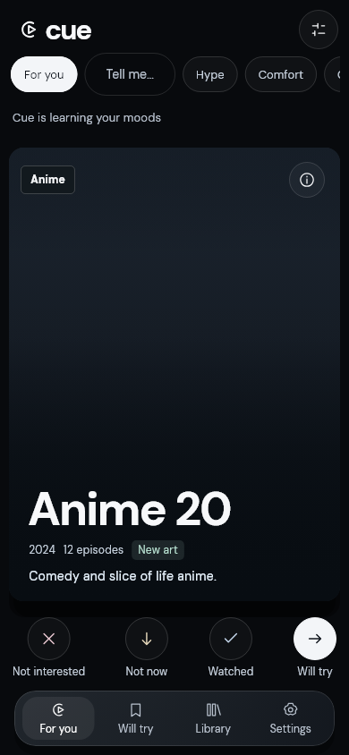

# Cue

A free, private way to find your next anime, comic, drama, series or movie.

[Open the web app](https://cue-next.cue-worker.workers.dev) ·
[Build the Android app](#android)



## What it does

- **One card at a time.** Swipe right to save, left for Not interested, up for
  Watched / Read it, or down for Not now. Buttons and keyboard work too.
- **Double-tap to Try now.** Prioritize a saved title for tonight without rating
  it. Single-tap still opens details; no extra gesture combinations.
- **Bring your library.** Import supported files or lists, review matches, and
  confirm before saving. Interrupted matching resumes locally.
- **Find something that fits.** Filter formats and genres, describe your mood,
  or explore a different direction. Cards explain why they were suggested.
- **Keep saved picks useful.** Browse your library, optionally rate titles,
  compare two saved picks, or choose from Tonight's picks.
- **Sync when you want.** Share an encrypted library between phone and web
  using a code—no Cue account required.

See the [feature guide](docs/FEATURES.md) for supported imports and controls.

## Privacy

- Your library lives on your device. Optional sync uploads an encrypted copy;
  keep its recovery code safe.
- Catalog lookups send title names or IDs, not your whole history. Optional AI
  mood hints send your typed sentence only when enabled. Optional "AI picks
  from my taste" (off by default) sends the names and years of up to 25 titles
  you liked and up to 10 you disliked, plus your enabled formats, to an AI
  service; never ratings, notes or dates. Every suggestion is checked against
  the real catalog before you see it.
- Technical diagnostics are **off by default** and exclude titles, history,
  search text, files, tokens and raw errors.
- No ads, trackers, third-party analytics SDKs or remote fonts.

[Privacy and data lifecycle](docs/PRIVACY.md) ·
[Diagnostics setup and retrieval](worker/DIAGNOSTICS.md)

## Quick start

Use Flutter **3.47.9** (the CI version), Node **22+**, and the Android SDK for
phone builds. Run the Worker and app in separate terminals.

### Worker

```sh
cd worker
npm ci
npx wrangler d1 migrations apply cue-sync --local
npx wrangler dev
```

### Web app

```sh
cd app
flutter pub get
flutter run -d chrome --web-port 7357
```

### Android

```sh
cd app
flutter pub get
flutter build apk --release
```

Install `app/build/app/outputs/flutter-apk/app-release.apk` on your phone.
Release signing uses `app/android/key.properties`; without it, the build uses
the **debug key**, not store-release credentials. Android emulator debug builds
use the local Worker; release builds use the configured hosted Worker.

[Development, optional keys and deployment](docs/SETUP.md)

## How recommendations work

Cue combines your explicit ratings, weak signals from unrated imported history,
and your current mood. It retrieves a bounded sample across enabled formats,
rather than downloading the whole catalog. Hard filters and existing-library
exclusions apply before ranking. The deck mixes familiar, adjacent and exploring
picks; temporary More/Less and Try now interest do not become permanent ratings.
If valid candidates run out, Cue offers recovery choices instead of silently
relaxing your filters.

[Recommendation details](docs/RECOMMENDATIONS.md)

## Project structure

```text
app/       Flutter UI, local database, ranking, imports and encrypted sync
worker/    Cloudflare API, catalog cache, sync storage and optional AI hints
fixtures/  Synthetic test data
docs/      Architecture, policies, setup and validation details
```

## More details

- [Architecture and data sources](docs/ARCHITECTURE.md)
- [Test results and known limitations](docs/TESTING.md)
- [Feature guide](docs/FEATURES.md)

Android and web are supported. iOS and additional sign-in providers are not
currently planned. Contributions should use synthetic fixtures—never commit a
real library export or credentials.
