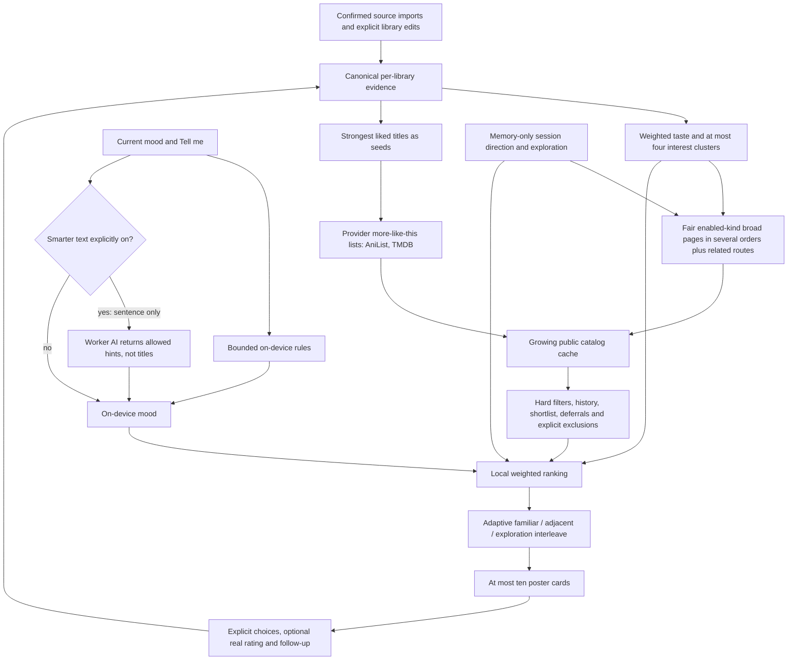

# Architecture

[Back to Cue](../README.md)

## Components

```text
 Flutter app (Android, web)             Cloudflare Worker
 +---------------------------+  HTTPS  +-------------------------------+
 | deck, ranker, live mood   | ------> | /catalog  TVmaze, Cinemeta,   |
 | imports, library, sync    |         |           MangaDex, MangaUpd. |
 | local SQLite (Drift)      |         | /oauth    MAL token exchange  |
 +-------------+-------------+         | /import   MAL list reads      |
               | HTTPS                | /sync     encrypted blobs (D1)|
               v                      | /ai/mood  Groq / Gemini hints |
       graphql.anilist.co             | /diagnostics technical events|
                                      +-------------------------------+
```

AniList is called directly from the device because it blocks Cloudflare.
Ranking, library evidence and live mood run on the device. The Worker exposes
fixed routes, not an arbitrary URL or GraphQL proxy.

**Stack:** Flutter, Riverpod, go_router, Drift; Cloudflare Workers, Hono,
zod, KV and D1. Tests use flutter_test and Vitest.

| Data | Source | Key required |
|---|---|---|
| Anime, manga, manhwa, manhua | AniList | No |
| K/C/J-dramas and series | TVmaze | No |
| Movies | Stremio Cinemeta (unofficial) | No |
| Comic alternate names | MangaDex, MangaUpdates | No |

Optional keys and account setup are covered in [Setup](SETUP.md).
An import source is not an additional recommendation provider.

## Recommendation flow



See [Recommendations](RECOMMENDATIONS.md) for exact weights and budgets, and
[Privacy](PRIVACY.md) for data boundaries.

## Source layout

```text
app/
  lib/app/          theme, routing, providers
  lib/features/     deck, library, imports, settings, sync screens
  lib/domain/       ranker, live mood, models
  lib/data/         local database, catalog, repositories
  lib/imports/      detection, adapters, title matching
  lib/sync/         end-to-end encrypted sync
worker/
  src/catalog/      providers and public cache
  src/imports/      MAL lists and token exchange
  src/sync/         encrypted D1 blob store
  src/diagnostics/  bounded technical-event storage
  src/ai/           optional Groq / Gemini mood hints
fixtures/           synthetic test files
```
